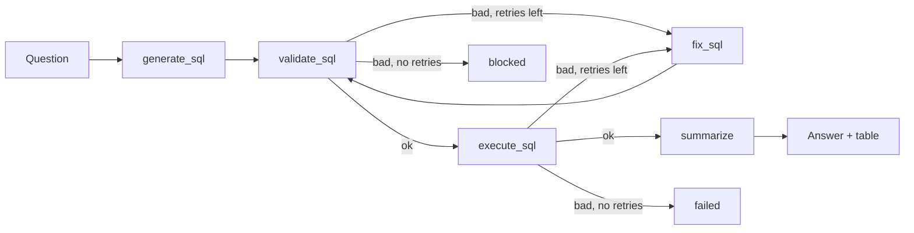

# SQL Analyst

[](https://github.com/JoshStevens582/sql-analyst/actions/workflows/ci.yml)

**Live demo:** **https://sql-analyst.102-203-81-249.sslip.io**  
(Portfolio HTTPS via Caddy; synthetic SQLite only — not the live ledger.)

English question → model drafts SQLite → **your code** allows only read-only `SELECT` → run on a **synthetic** database → plain-language answer.

**Repo:** [github.com/JoshStevens582/sql-analyst](https://github.com/JoshStevens582/sql-analyst)

This is not connected to the live warehouse ledger. Postgres and production stock live in [warehouse-ledger](https://github.com/JoshStevens582/warehouse-ledger).

## How it works



- **LangGraph** runs the steps and carries **state** (one dict per Ask: question, SQL, errors, rows, answer).
- **sqlglot** in `security.py` enforces read-only SQL before any execution.
- **SQLite** `mode=ro` on `data/demo.db` (seeded fake warehouse-style tables).

## Run locally

```bash
cd sql-analyst
uv sync --all-groups
uv run uvicorn sql_analyst.main:app --reload --port 8088
```

Open http://127.0.0.1:8088/

Copy `.env.example` to `.env` and set `OPENAI_API_KEY` for live SQL drafting. Without a key, the **stub** LLM runs (used in CI).

## Interview demo questions

Try these on the desk or via API:

1. `How many products are in the catalogue?` → expect **4**
2. `What is total revenue in cents excluding cancelled orders?` → expect **48600**
3. `What is the shelf stock per SKU?` → one row per SKU (sums of `stock_movements`)

See each LangGraph step in the terminal:

```bash
uv run python scripts/trace_one_question.py "How many products are in the catalogue?"
```

## Guardrails

- `sqlglot` rejects `INSERT`, `UPDATE`, `DELETE`, `DROP`, `ALTER`, and multi-statement scripts.
- Read-only DB connection; row cap (`SQL_ANALYST_MAX_ROWS`, default 200).

## Tests and evals

```bash
uv run ruff check .
uv run mypy .
uv run pytest
```

Eval cases: `evals/questions.json`, exercised in `tests/test_eval_cases.py`.

## Docker and deploy

```bash
docker compose up -d --build
# open http://127.0.0.1:8088
```

Portfolio VPS (Caddy + `cca-edge`): see [deploy/DEPLOY.md](deploy/DEPLOY.md).